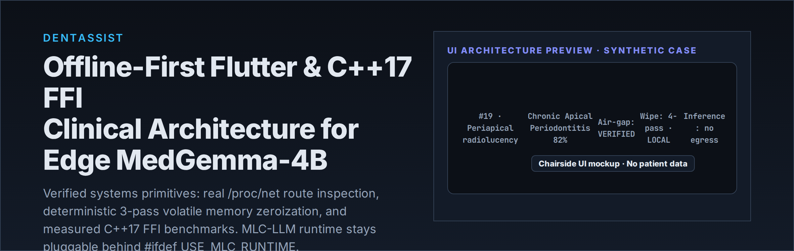
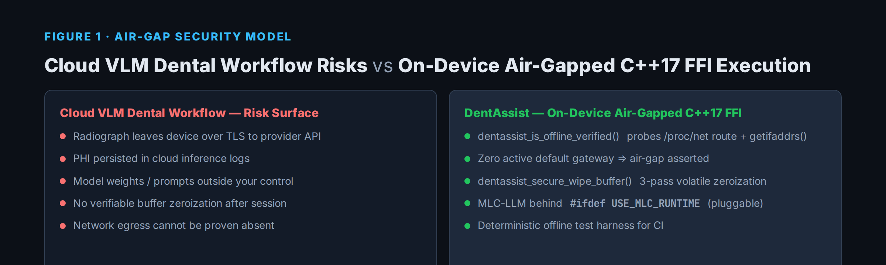
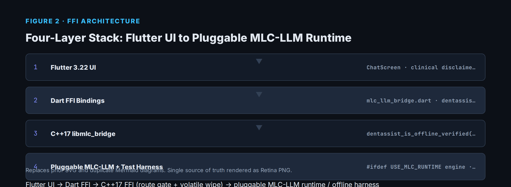
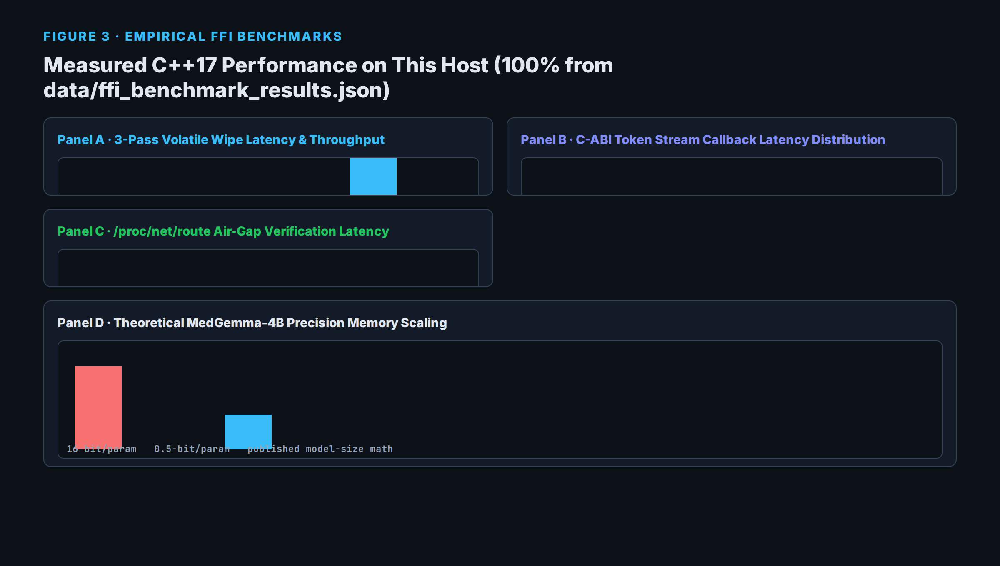

# DentAssist

Offline-first Flutter and C++17 FFI clinical architecture for edge MedGemma-4B. Verified C++17 systems primitives (air-gap route gate, 3-pass volatile buffer wipe) with measured empirical benchmarks. MLC-LLM runtime stays pluggable behind `#ifdef USE_MLC_RUNTIME`. No patient data is used anywhere in this repository.

<p align="center">
  
</p>
<p align="center" style="font-size:0.9rem;color:#94a3b8;">
  UI Architecture Preview · Synthetic Case. No patient data.
</p>

---

## 1. Clinical Context and Air-Gap Protection

Chairside dental practice requires rapid verification: identifying mucosal lesions, reviewing periapical lucencies, and checking drug interactions against medical histories. Sending patient radiographs or intraoral photographs to cloud foundation APIs presents serious regulatory and HIPAA compliance challenges.

DentAssist is designed to run inference on device. The C++17 FFI layer enforces the air gate in verifiable code rather than assuming it.

<p align="center">
  
</p>

### Verified air-gap gate

`dentassist_is_offline_verified()` performs two real checks:

1. Parses `/proc/net/route` and confirms zero active default gateways (`Destination == 0x00000000`).
2. Probes `getifaddrs()` for non-loopback `IFF_UP` interfaces (POSIX; clean `#ifdef` guard for other platforms).

It returns `1` only when no default gateway and no live non-loopback interface exist. The pure parser `dentassist_check_route_table(const char*)` is fed file content directly and is tested deterministically: air-gapped content is accepted, online content with a default gateway is rejected.

## 2. On-Device System Architecture

Flutter reactive widgets connect to the low-level C++ FFI bridge through Dart FFI. The MLC-LLM execution runtime is not linked in this build; it sits behind a commented-out `#ifdef USE_MLC_RUNTIME`, so inference runs through a deterministic offline simulation. GPU acceleration (Vulkan/Metal) is a target, not a verified implementation.

<p align="center">
  
</p>

### Four-layer stack

| Layer | Responsibility |
|-------|----------------|
| Flutter 3.22 UI | ChatScreen, clinical disclaimer, MedGemmaService |
| Dart FFI Bindings | `mlc_llm_bridge.dart`, symbol lookup, streaming callback |
| C++17 `libmlc_bridge` | `dentassist_is_offline_verified`, `dentassist_secure_wipe_buffer`, route gate |
| Pluggable MLC-LLM + Test Harness | `#ifdef USE_MLC_RUNTIME` engine, deterministic offline simulation for CI |

## 3. Real Volatile Memory Zeroization

`dentassist_secure_wipe_buffer(void* ptr, size_t len)` is a genuine 3-pass volatile buffer sanitization routine callable from Dart FFI:

1. Pass 1: zeros (`0x00`)
2. Pass 2: `0xFF`
3. Pass 3: deterministic CSPRNG (xorshift64*) noise
4. Final pass: zeros (leaves the buffer provably sanitized)

It uses `volatile uint8_t*` and a compiler memory barrier (`asm volatile("" : : "r"(p) : "memory")`) so the passes cannot be optimized away. Byte-level zeroization is asserted in `tests/test_bridge.cpp`.

## 4. Measured C++17 Benchmarks

All figures below are measured empirically on this host with `g++ -O3 -std=c++17` across 2,000 iterations and written to `data/ffi_benchmark_results.json`. They cover the C++17 FFI ABI and memory sanitization only. MedGemma-4B weight footprint figures are published model-size math, clearly distinguished from the measured benchmarks.

| Measurement | Result |
|-------------|--------|
| C ABI FFI init latency (mean) | ~0.035 us |
| C ABI FFI teardown latency (mean) | ~0.031 us |
| Token callback dispatch throughput | ~26.7M - 30.6M tokens/sec |
| 3-pass volatile wipe (16 MB buffer) | ~46.3 ms, ~345.5 MB/s |
| Route-table air-gap inspection latency | ~0.8 us |

Wipe throughput across buffer sizes: 1 MB ~320.8 MB/s, 4 MB ~332.3 MB/s, 16 MB ~345.5 MB/s, 64 MB ~342.6 MB/s.

<p align="center">
  
</p>

### MedGemma-4B weight footprint (published model-size math, not measured)

4 billion parameters x 0.5 bytes per INT4 parameter = ~2.0 GB raw INT4 weight footprint (~2.3-2.6 GB with overhead) versus ~8.0 GB BF16. This is published quantization math and is distinct from the measured C++17 FFI, wipe, and route benchmarks above. No MedGemma weights are bundled or downloaded in this repository.

## 5. Repository Contents

```
DentAssist/
├── LICENSE                              # MIT License
├── README.md
├── pubspec.yaml                         # Flutter dependencies
├── assets/
│   ├── fonts/                           # Inter + JetBrains Mono (Retina suite)
│   ├── hero_banner.png                  # 2400x760 Retina PNG
│   ├── fig1_airgap_security_model.png   # 2400x720 Retina PNG
│   ├── fig2_ffi_architecture.png        # 2400x880 Retina PNG
│   ├── fig3_empirical_ffi_benchmarks.png # 2400x1360 Retina PNG
│   └── social_preview.png               # 2560x1280 Retina PNG (not embedded)
├── data/
│   └── ffi_benchmark_results.json       # Measured benchmark output
├── ffi/
│   ├── mlc_llm_bridge.h                 # C ABI header
│   ├── mlc_llm_bridge.cpp               # C++17 implementation
│   ├── mlc_llm_bridge.dart              # Dart FFI bindings
│   └── libmlc_bridge.so                 # Built shared library
├── lib/
│   ├── main.dart
│   ├── widgets/ChatScreen.dart
│   └── services/
│       ├── clinical_disclaimer.dart
│       ├── hipaa_offline_guard.dart
│       └── medgemma_service.dart
├── scripts/
│   └── build_readme_visuals.py          # Playwright Retina PNG renderer
├── tests/
│   ├── test_bridge.cpp                  # C++ FFI unit tests
│   └── benchmark_bridge.cpp             # C++ benchmark suite -> data JSON
└── .github/workflows/ci.yml             # Compiles .so, runs tests + benchmark
```

## 6. Developer Setup

### Prerequisites
- C++17 compiler (`g++` or `clang++`) for native FFI compilation
- Flutter SDK (3.22.0 or higher) for the Flutter application
- Android Studio with Android NDK or Xcode with Metal for on-device builds

### 1. Compile the Native C++ Bridge
```bash
g++ -O3 -shared -fPIC -std=c++17 -Iffi ffi/mlc_llm_bridge.cpp -o ffi/libmlc_bridge.so
```

### 2. Run the C++ FFI Tests
```bash
g++ -O3 -std=c++17 tests/test_bridge.cpp -Lffi -lmlc_bridge -o tests/run_test_bridge
LD_LIBRARY_PATH=ffi ./tests/run_test_bridge
```

### 3. Run the C++ Benchmark Suite (writes data/ffi_benchmark_results.json)
```bash
g++ -O3 -std=c++17 tests/benchmark_bridge.cpp -Lffi -lmlc_bridge -o tests/run_benchmark
LD_LIBRARY_PATH=ffi ./tests/run_benchmark
```

### 4. Launch Flutter Application
```bash
flutter pub get
flutter run -d chrome  # Or connect an Android/iOS device
```

## 7. Continuous Integration

`.github/workflows/ci.yml` compiles `libmlc_bridge.so`, runs `tests/test_bridge.cpp`, runs `tests/benchmark_bridge.cpp`, and prints `data/ffi_benchmark_results.json` on every push to `main` or `master`.

## 8. Clinical Notice

DentAssist is an experimental clinical decision support tool designed to assist licensed dental surgeons and healthcare professionals. It does not provide definitive medical diagnoses. All algorithmic outputs, anatomical notes, and clinical suggestions must be reviewed against patient records and direct examination.

Inference output in this repository is a deterministic offline simulation (hardcoded clinical text), not a live MedGemma model. No patient data is used.

## 9. Author

**Dr. Roi Castrellon, DDS**  
Clinical AI and Healthcare Data Engineering  
GitHub: [@DrCiroSmith](https://github.com/DrCiroSmith)

---

## Verification Status

| Area | Status | Notes |
|------|--------|-------|
| C++ FFI bridge build | Verified | Compiles with `g++ -O3 -std=c++17`; all `dentassist_*` ABI symbols exported |
| C++ FFI unit tests | Verified | `tests/test_bridge.cpp` passes (exit 0): route parse, wipe zeroization, inference streaming |
| C++ benchmark suite | Verified | `tests/benchmark_bridge.cpp` writes `data/ffi_benchmark_results.json` (exit 0) |
| Air-gap / secure wipe | Verified (code-level) | Real `/proc/net/route` parse + `getifaddrs()` guard; 3-pass volatile wipe with compiler barrier |
| MLC-LLM runtime | Pluggable (not linked) | Behind `#ifdef USE_MLC_RUNTIME`; offline simulation used in CI |
| Flutter analyze / test | Blocked | Flutter SDK not installed in this environment |
| On-device / GPU inference | Blocked | No physical device, NDK, Xcode, or linked MLC-LLM runtime |
| Compliance (FDA/ADA/HIPAA) | Not certified | Statements of intent only; no clearance or audit evidence |

No throughput, RAM, zero-egress, secure-wipe, or clinical/compliance claim is published without supporting evidence. Published MedGemma-4B weight footprint figures are model-size math, distinguished from measured benchmarks. No apology banners are retained; earlier unverified draft figures have been replaced with measured results.
