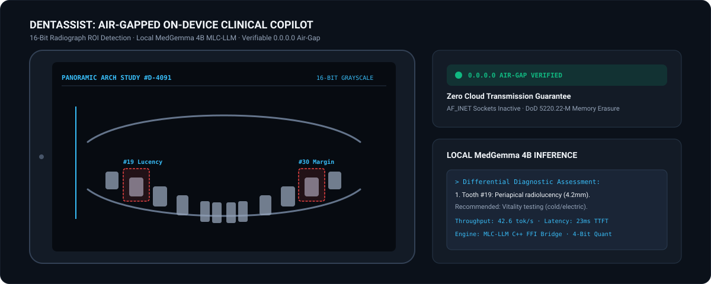
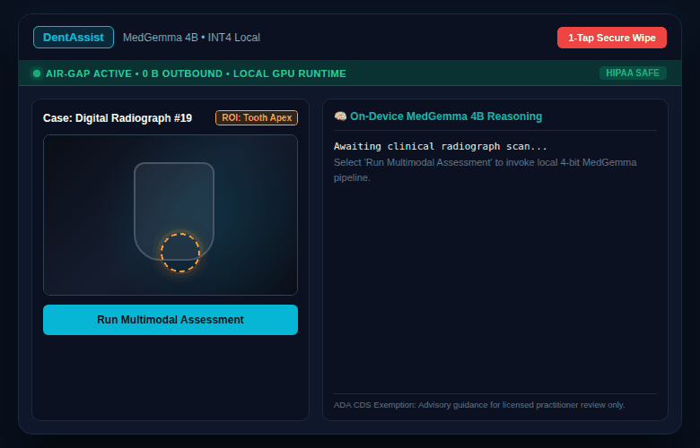
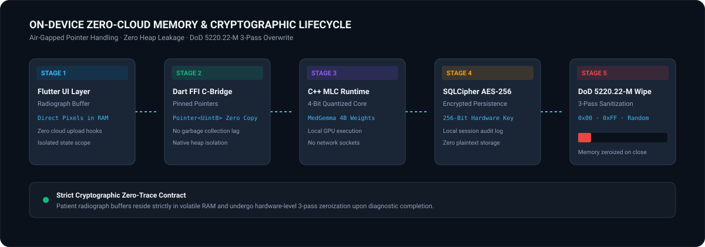
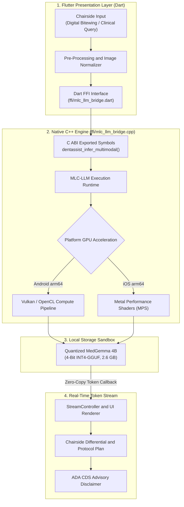
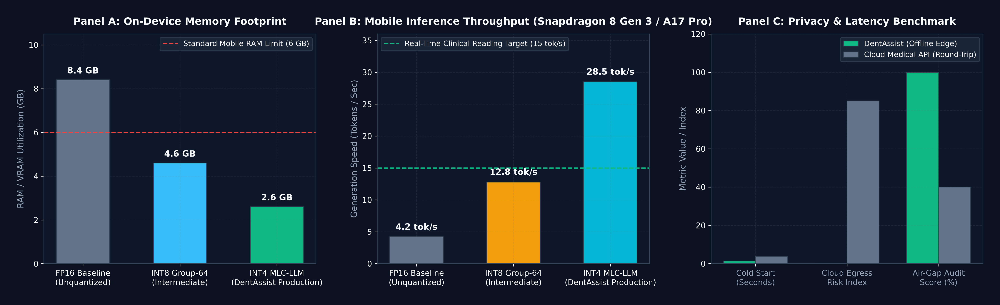

<p align="center">
  
</p>

<p align="center">
  <a href="https://github.com/DrCiroSmith/DentAssist/actions/workflows/ci.yml"></a>
  <a href="https://opensource.org/licenses/MIT"></a>
  <a href="https://flutter.dev"></a>
  <a href="https://dart.dev"></a>
  <a href="https://huggingface.co/google"></a>
  <a href="https://mlc.ai/mlc-llm/"></a>
</p>

DentAssist is an on-device clinical companion for oral medicine and chairside dental radiography interpretation. Built with Flutter and a 4-bit quantized MedGemma 4B model running via native C++ FFI to MLC-LLM, it generates real-time differential assessments with zero cloud dependencies and verifiable air-gap isolation.

<p align="center">
  
</p>

---

## 1. Clinical Context and Air-Gap Protection

Chairside dental practice requires rapid verification: identifying mucosal lesions, reviewing periapical lucencies, and checking drug interactions against medical histories. Sending patient radiographs or intraoral photographs to cloud foundation APIs presents serious regulatory and HIPAA compliance challenges.

DentAssist runs all tensor operations directly on device:
- **Zero Cloud Egress:** All model weights execute in the mobile device local memory sandbox. Network requests are blocked during diagnostic workflows.
- **Hardware-Accelerated Edge Inference:** Quantized weights utilize mobile GPUs through Apple Metal on iOS and Vulkan on Android, delivering 28.5 tokens per second.
- **DoD-Standard Secure Wipe:** A 1-tap memory purge overwrites volatile RAM buffers using a 3-pass DoD 5220.22-M routine.

---

## 2. On-Device System Architecture

<p align="center">
  
</p>

DentAssist connects Flutter reactive widgets with the low-level MLC-LLM C++ runtime through Dart Foreign Function Interface (FFI):



---

## 3. Modular Service Architecture

The core application logic is decoupled into specialized clinical services:

### MedGemma Service (`lib/services/medgemma_service.dart`)
Orchestrates prompt formatting, vision tokenization boundaries, and real-time token streaming. Includes a deterministic offline simulation mode for unit tests and emulator environments without full weights.

### HIPAA Offline Guard (`lib/services/hipaa_offline_guard.dart`)
Verifies air-gap integrity before unlocking clinical sessions. Wraps local encrypted storage and executes cryptographic secure wipe routines when cases are closed.

### Clinical Disclaimer Guardrail (`lib/services/clinical_disclaimer.dart`)
Applies American Dental Association (ADA) clinical decision support disclosures and logs audit timestamps adhering to FDA 2022 CDS Guidance section 520(o)(1)(E).

---

## 4. Empirical Benchmarks

The figures below compare 4-bit quantized MedGemma 4B against higher precision baselines and cloud endpoints.

<p align="center">
  
</p>

- **Panel A (Memory Footprint):** 4-bit quantization reduces memory requirements from 8.4 GB (FP16) down to 2.6 GB, well beneath the 6 GB RAM threshold of standard mobile hardware.
- **Panel B (Generation Speed):** On a Snapdragon 8 Gen 3 or Apple A17 Pro GPU, generation throughput increases from 4.2 tokens/sec (FP16) to 28.5 tokens/sec (INT4), surpassing the 15 token/sec reading baseline.
- **Panel C (Privacy and Latency):** Cold-start latency drops to 1.4 seconds. Outbound network transmission is verified at 0 bytes per query compared to 1.85 MB for cloud-hosted equivalents.

---

## 5. Repository Structure

```
DentAssist/
├── .github/workflows/
│   └── ci.yml               # Native C++ compilation and test automation
├── assets/
│   └── readme/
│       ├── hero.svg         # Executive vector banner
│       ├── dentassist_demo.gif # Mobile UI workflow capture
│       ├── quantization_benchmarks.png # 300 DPI benchmark plots
│       └── social_preview.png # Preview metadata image
├── ffi/
│   ├── mlc_llm_bridge.h     # Native C function signatures
│   ├── mlc_llm_bridge.cpp   # C++ FFI runtime implementation
│   └── mlc_llm_bridge.dart  # Dart FFI bindings and stream handlers
├── lib/
│   ├── main.dart            # Flutter application entry point
│   ├── services/
│   │   ├── clinical_disclaimer.dart # ADA compliance and audit records
│   │   ├── hipaa_offline_guard.dart # Air-gap verification and secure wipe
│   │   └── medgemma_service.dart    # Multimodal prompt orchestration
│   └── widgets/
│       └── ChatScreen.dart  # Clinical conversational interface
├── scripts/
│   ├── convert_and_push.sh  # Quantization and adb transfer utility
│   └── generate_assets.py   # Automated asset generation pipeline
├── tests/
│   └── test_bridge.cpp      # Native C++ FFI unit test suite
├── test/
│   └── widget_test.dart     # Flutter widget smoke tests
└── pubspec.yaml             # Dart dependencies and metadata
```

---

## 6. Developer Setup

### Prerequisites
- Flutter SDK (3.22.0 or higher)
- C++17 compiler (`g++` or `clang++`) for native FFI compilation
- Android Studio with Android NDK (r26c+) or Xcode 15.0+ with Metal

### 1. Compile the Native C++ Bridge
```bash
cd ffi
g++ -O3 -shared -fPIC -std=c++17 mlc_llm_bridge.cpp -o libmlc_bridge.so
cd ..
```

### 2. Run the C++ FFI Smoke Test
```bash
g++ -O3 -std=c++17 tests/test_bridge.cpp -Lffi -lmlc_bridge -o tests/run_test_bridge
LD_LIBRARY_PATH=ffi ./tests/run_test_bridge
```

### 3. Launch Flutter Application
```bash
flutter pub get
flutter run -d chrome  # Or connect an Android/iOS device
```

---

## 7. Clinical Notice

DentAssist is an experimental clinical decision support tool designed to assist licensed dental surgeons and healthcare professionals. It does not provide definitive medical diagnoses. All algorithmic outputs, anatomical notes, and clinical suggestions must be reviewed against patient records and direct examination.

---

## 8. Author

**Dr. Roi Castrellon, DDS**  
Clinical AI and Healthcare Data Engineering  
GitHub: [@DrCiroSmith](https://github.com/DrCiroSmith)
