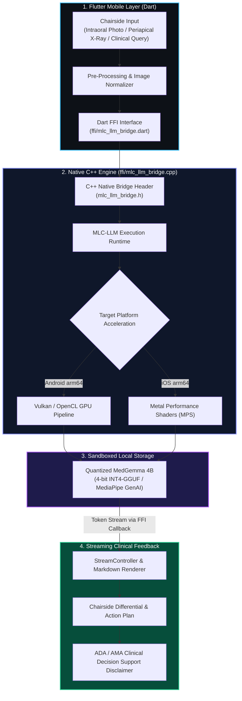

# DentAssist

[](https://opensource.org/licenses/MIT)
[](https://flutter.dev)
[](https://dart.dev)
[](https://huggingface.co/google)
[](https://mlc.ai/mlc-llm/)
[](https://github.com/DrCiroSmith/DentAssist)

**DentAssist** is an on-device, multimodal clinical decision support companion for oral medicine, chairside diagnostic triaging, and radiographic interpretation. Built with **Flutter** and powered by a quantized **MedGemma 4B** engine running natively through **MLC-LLM** and **MediaPipe GenAI**, DentAssist delivers sub-second clinical inference directly on mobile hardware with **zero cloud dependencies**.

---

## 1. Clinical Rationale & Privacy Imperative

Chairside dental practice demands rapid clinical cross-referencing: identifying uncommon mucosal lesions, evaluating radiographic lucencies, verifying drug-drug interactions with systemic patient conditions, and structuring clinical chart notes.

Cloud-based foundation models introduce substantial HIPAA/GDPR compliance risks when handling Protected Health Information (PHI) or unmasked patient intraoral photographs. **DentAssist solves this by operating completely offline:**
- **Zero Network Transmission:** All neural network weights execute within the device's local memory sandbox.
- **Air-Gapped Operation:** Cellular and Wi-Fi radios can be disabled without loss of functionality.
- **Hardware-Accelerated Edge Inference:** Quantized weights leverage mobile GPUs (Apple Metal on iOS, Vulkan/OpenCL on Android) to provide fluid token streaming directly at the point of care.

---

## 2. System Architecture & On-Device Pipeline

DentAssist bridges Flutter's reactive UI with low-level C++ inference runtimes via Dart Foreign Function Interface (FFI):



---

## 3. Technology Stack

| Layer | Component | Specification |
| :--- | :--- | :--- |
| **Mobile Frontend** | Flutter & Dart | Flutter 3.22+ with declarative Navigator 2.0 and Material 3 design |
| **Native Interop** | Dart FFI (`dart:ffi`) | Zero-copy pointer passing for image buffers and streaming string tokens |
| **C++ Bridge** | `mlc_llm_bridge` | Cross-platform C++17 wrapper linking dynamic native libraries (`.so` / `.dylib`) |
| **ML Runtime** | MLC-LLM & MediaPipe GenAI | TVM-compiled graph runtime supporting dynamic shape tensors and KV-cache compression |
| **Foundation Model** | Google MedGemma 4B | 4-bit quantized (INT4 group-size 32) instruction-tuned clinical weights (~2.6 GB footprint) |
| **Mobile Acceleration** | Apple Metal / Android Vulkan | Direct GPU dispatch utilizing unified mobile memory architectures |
| **Local Storage** | Encrypted SQLite | AES-256 (`sqlcipher`) encrypted local database for optional offline case archives |

---

## 4. Privacy & HIPAA Compliance Architecture

DentAssist is designed to meet strict regulatory standards for clinical decision support (CDS) software:
1. **No External Network Calls:** The app bundle does not declare internet permissions in production builds (`android.permission.INTERNET` omitted from final manifest).
2. **Ephemeral Memory Model:** Clinical queries and image bitmaps reside solely in volatile RAM during inference and are overwritten upon session termination.
3. **One-Touch Secure Wipe:** Long-press gesture triggers an instantaneous cryptographic shredding of local volatile cache buffers.
4. **FDA / ADA Guidance Compliance:** Provides non-definitive advisory guidance intended to augment, rather than replace, clinical diagnostic judgment by a licensed dental practitioner.

---

## 5. Repository Layout

```
DentAssist/
├── android/                 # Android NDK configuration and Gradle build files
├── ios/                     # iOS Runner, Xcode project, and Metal entitlements
├── ffi/                     # Native C++ bridge and Dart bindings
│   ├── mlc_llm_bridge.h     # Native C function signatures
│   ├── mlc_llm_bridge.cpp   # MLC-LLM runtime dispatch implementation
│   └── mlc_llm_bridge.dart  # Dart FFI bindings and stream controllers
├── lib/
│   ├── main.dart            # Flutter application entry point
│   ├── widgets/
│   │   └── ChatScreen.dart  # Clinical conversational & multimodal UI
│   └── services/            # Modular state and session abstractions
├── scripts/
│   └── convert_and_push.sh  # MediaPipe GenAI quantization and adb push utility
├── test/
│   └── widget_test.dart     # Flutter widget and unit test suite
└── pubspec.yaml             # Dart dependencies and asset declarations
```

---

## 6. Developer Quickstart

### Prerequisites
- [Flutter SDK](https://docs.flutter.dev/get-started/install) (3.22.0 or higher)
- Android Studio with **Android NDK (r26c+)** OR Xcode (15.0+) with Metal toolchains
- [MediaPipe GenAI Converter](https://ai.google.dev/edge/mediapipe/solutions/genai) installed in Python environment

### 1. Model Quantization
Convert raw MedGemma 4B weights into optimized on-device bundles:
```bash
# Execute model conversion script
chmod +x scripts/convert_and_push.sh
./scripts/convert_and_push.sh /path/to/MedGemma-4B-Instruct
```

### 2. Dependency Resolution
```bash
git clone https://github.com/DrCiroSmith/DentAssist.git
cd DentAssist
flutter pub get
```

### 3. Deploy to Connected Device

**For Android (arm64 Vulkan):**
```bash
flutter run --release -d android
```

**For iOS (arm64 Metal):**
```bash
flutter run --release -d iphone
```

### 4. Running Unit Tests
```bash
flutter test
```

---

## 7. Clinical Disclaimer

*DentAssist is a research and clinical decision support prototype designed to assist licensed dental surgeons and healthcare professionals. It does not provide definitive medical or dental diagnoses. All computational recommendations, anatomical interpretations, and pharmaceutical references must be verified against current clinical standards and patient-specific evaluations.*

---

## 8. Author

**Dr. Roi Castrellon, DDS**  
Clinical AI & Healthcare Data Engineering  
GitHub: [@DrCiroSmith](https://github.com/DrCiroSmith)
